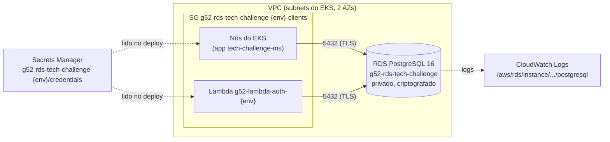

# g52-infra-rds-tech-challenge

Terraform do banco de dados gerenciado do Tech Challenge (Grupo 52): **Amazon RDS for PostgreSQL 16**, usado pela aplicação principal (EKS) e pela Lambda de autenticação por CPF.

**Modelo de dados:** o diagrama ER, a explicação dos relacionamentos, a justificativa da escolha do PostgreSQL/RDS e os ajustes feitos no modelo estão em [`docs/modelo-de-dados.md`](docs/modelo-de-dados.md).

## Links

| | |
|---|---|
| Documentação da API (Swagger) | https://teplotax.github.io/doc-api-tech-challenge-v1/ |
| Collection Postman/Insomnia | Enviada no PDF de entrega, porque contém CPFs de teste do seed |
| Arquitetura da solução (diagramas, RFCs, ADRs) | [`g52-app-tech-challenge/docs/arquitetura`](https://github.com/Teplotax/g52-app-tech-challenge/tree/main/docs/arquitetura) |
| Pipelines | [GitHub Actions](https://github.com/Teplotax/g52-infra-rds-tech-challenge/actions) |

### Deploys

Todos os ambientes respondem pelo mesmo API Gateway, com um stage por ambiente:

| Ambiente | URL base | Healthcheck |
|---|---|---|
| dev | https://08onkvn4jb.execute-api.us-east-1.amazonaws.com/dev | [`/dev/health`](https://08onkvn4jb.execute-api.us-east-1.amazonaws.com/dev/health) |
| hom | https://08onkvn4jb.execute-api.us-east-1.amazonaws.com/hom | [`/hom/health`](https://08onkvn4jb.execute-api.us-east-1.amazonaws.com/hom/health) |
| prod | https://08onkvn4jb.execute-api.us-east-1.amazonaws.com/prod | [`/prod/health`](https://08onkvn4jb.execute-api.us-east-1.amazonaws.com/prod/health) |

Para economizar, os ambientes ficam desligados quando não estão em uso ([ADR-003](https://github.com/Teplotax/g52-app-tech-challenge/blob/main/docs/arquitetura/adrs/ADR-003-ambientes.md)). O healthcheck mostra se um ambiente está no ar.

## Arquitetura



- O banco não tem acesso público (`publicly_accessible = false`). O SG do RDS só aceita a porta 5432 vinda do SG **clients**.
- O SG **clients** é criado aqui e anexado pelos consumidores: os nós do EKS (repo `g52-infra-eks-tech-challenge`) e a Lambda (repo `g52-lambda-tech-challenge`). Assim, recriar o EKS ou a Lambda não exige mexer nas regras do banco.
- A senha é gerada pelo Terraform (`random_password`) e guardada no Secrets Manager, **sem rotação automática**. A app e a Lambda recebem as credenciais por variável de ambiente no deploy, e uma rotação quebraria a conexão até o próximo deploy.
- O TLS é obrigatório (`rds.force_ssl = 1`). Queries acima de 500 ms vão para o log do Postgres, exportado para o CloudWatch.

## Recursos

| Recurso | Descrição |
|---|---|
| `aws_db_instance.this` | PostgreSQL 16, `db.t4g.micro` no dev e `db.t3.micro` em hom/prod (sem capacidade de `t4g` nas AZs usadas), gp3 20 GB (autoscaling até 50 GB), criptografado, backup automático |
| `aws_db_subnet_group.this` | Subnets das 2 AZs (as mesmas do EKS) |
| `aws_security_group.rds` / `aws_security_group.clients` | Acesso ao banco restrito a quem anexar o SG `clients` |
| `aws_db_parameter_group.this` | `rds.force_ssl` e `log_min_duration_statement` |
| `aws_secretsmanager_secret.credentials` | `{engine, host, port, dbname, username, password}` |
| `aws_cloudwatch_log_group.postgresql` | Logs do Postgres com retenção configurável |

### Variáveis (`infra/inventories/dev/terraform.tfvars`)

| Variável | Descrição |
|---|---|
| `db_identifier` | Nome da instância. Também compõe os nomes do secret (`<id>/credentials`) e do SG de clientes (`<id>-clients`), que os outros repositórios usam para encontrar o banco |
| `subnet_ids` | Subnets do subnet group (mínimo de 2 AZs) |
| `engine_version`, `instance_class`, `allocated_storage`, `max_allocated_storage` | Dimensionamento |
| `db_name`, `db_username` | Banco e usuário master |
| `backup_retention_period` | Dias de backup. O padrão é 1, porque contas no free tier não aceitam mais que isso |
| `multi_az` | Standby em outra AZ (desligado no dev por custo) |
| `destroy` | `true` faz o pipeline executar `terraform destroy` |

### Outputs

`address`, `port`, `db_name`, `credentials_secret_arn`, `credentials_secret_name`, `clients_security_group_id` e `clients_security_group_name`.

## Ordem de deploy

O banco é a base dos outros repositórios:

1. **g52-infra-rds-tech-challenge** (este)
2. **g52-infra-eks-tech-challenge**: anexa o SG `clients` aos nós
3. **g52-lambda-tech-challenge**: lê endpoint e credenciais do RDS e anexa o SG `clients`
4. **g52-app-tech-challenge**: o deploy lê o secret e aplica no ConfigMap/Secret. O Flyway cria o schema e o seed no primeiro start

Para destruir, use a ordem inversa: o SG `clients` não pode ser apagado enquanto estiver anexado aos nós do EKS ou à Lambda.

## Execução manual

```bash
cd infra
terraform init -reconfigure \
  -backend-config="bucket=g52-terraform-state-dev-<account-id>" \
  -backend-config="key=dev/g52-rds-tech-challenge-dev/terraform.tfstate" \
  -backend-config="region=us-east-1"

terraform plan  -var-file=inventories/dev/terraform.tfvars
terraform apply -var-file=inventories/dev/terraform.tfvars
```

Para pegar as credenciais:

```bash
aws secretsmanager get-secret-value --secret-id g52-rds-tech-challenge-dev/credentials --query SecretString --output text
```

## Deploy (CI/CD)

```
feature/** -> develop -> release/vX.X.X -> main
```

| Workflow | Gatilho | Ação |
|---|---|---|
| `1 - [FEAT] Build & PR` | Push em `feature/**` | Abre PR automático para `develop` |
| `2 - [DEV] Build and Deploy` | Merge em `develop` | Deploy em **dev** (`terraform apply` ou `destroy`); cria a branch e o PR `release/vX.X.X` |
| `3 - [HOM] Deploy & Promote` | Merge do PR em `release/**` | Deploy em **hom** e abre o PR da release para `main` |
| `5 - [PROD] Deploy` | Merge em `main` | Deploy em **prod** |
| `Deploy` (`deploy.yml`) | Chamado pelos anteriores | Deploy reutilizável, parametrizado por ambiente |

A autenticação na AWS é via OIDC com o role `github-actions-terraform-dev`.

### Ambientes

| Ambiente | Branch | Quando sobe | `destroy` padrão | Configuração |
|---|---|---|---|---|
| **dev** | `develop` | Push em `develop` | `true` (sobe só quando precisa) | `infra/inventories/dev` (`g52-rds-tech-challenge-dev`) |
| **hom** | `release/*` | Merge do PR `develop` → `release/*` | `false` (fica no ar) | `infra/inventories/hom` (`g52-rds-tech-challenge-hom`) |
| **prod** | `main` | Merge do PR `release/*` → `main` | `true` (ligado só para demonstração) | `infra/inventories/prod` (`g52-rds-tech-challenge-prod`) |

O deploy fica no workflow reutilizável `deploy.yml`, chamado pelos três gatilhos com o ambiente como parâmetro. Cada ambiente usa o ambiente de mesmo nome no GitHub (`Settings → Environments`), com a variável `AWS_ACCOUNT_ID`. O state do Terraform fica no bucket `g52-terraform-state-dev-<account>`, na chave `<ambiente>/...`.

A branch `main` é protegida: não aceita push direto, e o merge só acontece por Pull Request.

## Tecnologias

Terraform (AWS provider 6), Amazon RDS for PostgreSQL, Secrets Manager, CloudWatch Logs, GitHub Actions.

## Repositórios do projeto

| Repositório | Conteúdo |
|---|---|
| [g52-app-tech-challenge](https://github.com/Teplotax/g52-app-tech-challenge) | Aplicação Spring Boot, manifestos Kubernetes e documentação de arquitetura |
| [g52-lambda-tech-challenge](https://github.com/Teplotax/g52-lambda-tech-challenge) | Function Serverless de autenticação (CPF e `client_credentials`) e Lambda Authorizer |
| [g52-infra-eks-tech-challenge](https://github.com/Teplotax/g52-infra-eks-tech-challenge) | Cluster EKS, ECR, add-ons e observabilidade (New Relic) |
| **g52-infra-rds-tech-challenge** (este) | Banco gerenciado (RDS PostgreSQL) e modelo de dados |
| [g52-infra-gateway-tech-challenge](https://github.com/Teplotax/g52-infra-gateway-tech-challenge) | REST API do API Gateway e roles da conta |
| [g52-api-tech-challenge-v1-ext](https://github.com/Teplotax/g52-api-tech-challenge-v1-ext) | Contrato OpenAPI importado no API Gateway (stages dev/hom/prod) |
| [doc-api-tech-challenge-v1](https://github.com/Teplotax/doc-api-tech-challenge-v1) | Swagger publicado no GitHub Pages |
